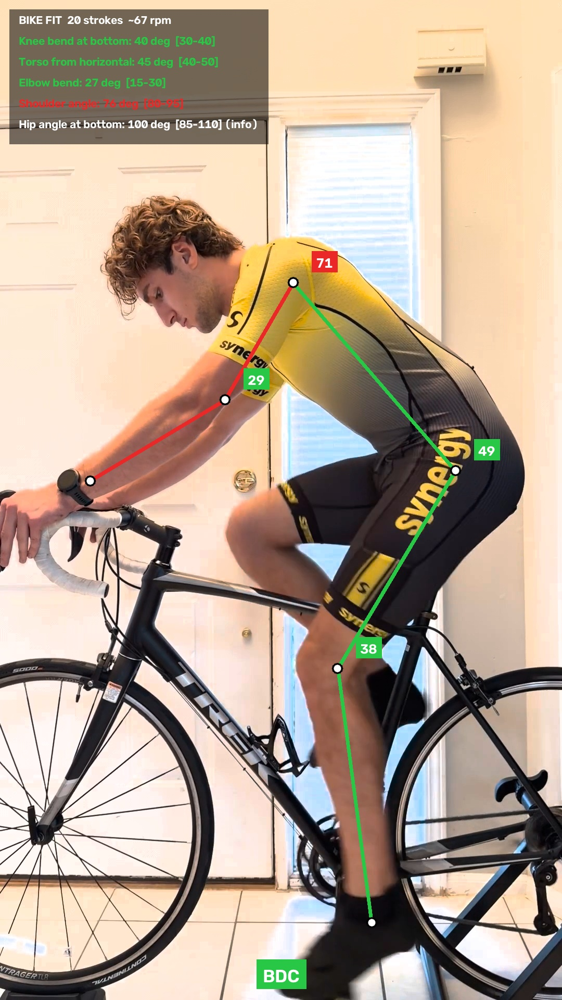

# bike_fit_analyzer

Grades a road-bike fit from a 20-second phone video of you pedaling on a
trainer. It finds your joints with pose estimation, measures the angles that
matter at the bottom of every pedal stroke, grades each one green / amber /
red against published fit ranges, and tells you what to change in plain
English, e.g. *"knee 45° at the bottom → saddle too low, raise ~15 mm."*

<p align="center">
  
</p>

## Example: dialing in a saddle height

Two clips of the same rider, filmed before and after raising the saddle ~29 mm
([full log](bike-fit/results/FIT_LOG.md)):

| | Lower saddle | Higher saddle | Green zone |
|---|---|---|---|
| Knee bend at bottom | 40° (top edge) | 27° **red**: too high | 30–40° |
| Torso from horizontal | 45° | 44° | 40–50° |
| Elbow bend | 27° | 24° | 15–30° |
| Shoulder angle | 76° **red** | 77° **red** | 80–95° |

The result: settle the saddle about halfway between the two heights, and
fit a +10 mm stem to open up the shoulder angle. Each run produces a
[report](bike-fit/results/video1/report.md), an annotated overlay video and
machine-readable [results](bike-fit/results/video1/results.json).

## How it works

1. **Normalize the video.** ffmpeg applies the phone's rotation and converts
   to H.264 at up to 60 fps / 1920 px.
2. **Find the joints.** YOLO11x-pose (ultralytics) detects 17 COCO keypoints
   per frame. The tool keeps the most confident person and the camera-side
   shoulder, elbow, wrist, hip, knee and ankle, ignoring points below 0.5
   confidence and frames where a limb segment's length jumps.
3. **Detect pedaling.** Seated pedaling means the knee swings 25°+ within a
   2-second window while the hip stays planted. That filters out mounting,
   walking around and coasting automatically.
4. **Measure at bottom dead center.** The knee's most-extended frame on each
   stroke is BDC. Angles are measured there on every stroke and the median is
   used, so one blurry frame can't skew the result.
5. **Grade and advise.** Each angle is graded against its green zone (amber =
   within 2.5°, since a phone video resolves angles to a few degrees). For the
   saddle, the tool estimates the millimetres needed to bring the knee into
   range from your leg proportions in the video, scaled by your height.

### Grading ranges (dynamic, road, measured while pedaling)

| Angle | Green | If it's off |
|---|---|---|
| Knee bend at bottom | 30–40° | over ~42° saddle too low; under ~28° saddle too high |
| Torso from horizontal | 40–50° | lower = aggressive front end, higher = upright |
| Elbow bend | 15–30° | under = arms locked (reach too long) |
| Shoulder (torso to upper arm) | 80–95° | under = closed cockpit (reach short or weight on hands) |
| Hip (torso to thigh) at bottom | 85–110° | info only, flexibility dependent |

The knee zone is the Holmes method's static 25–35° plus the ~8° that measuring
dynamically on video adds (Bini et al. 2014, PubMed 24499342). Field averages
are knee 36 ± 7° and elbow 19 ± 8° (PMC9219349). Torso, shoulder and hip ranges
are practitioner ranges (bikefitadviser.com, "Not basic bike fit, part 3").

Saddle setback (fore-aft) isn't measured. Change one thing at a time and re-film.

## Run it

Requires Python 3 and [ffmpeg](https://ffmpeg.org/) on your PATH.

```
cd bike-fit
pip install -r requirements.txt
python bike_fit.py path/to/video.mov --height-cm 180
```

The first run downloads the `yolo11x-pose.pt` model (~113 MB). Pose estimation
is slow on CPU; keypoints are cached, so re-running a video is fast (`--fresh`
forces a new pass). Results go to `bike-fit/results/<video name>/`:

| File | What |
|---|---|
| `overlay.mp4` | the whole clip with the color-graded skeleton |
| `bdc_still.jpg` | a representative bottom-of-stroke frame |
| `report.md` | angles, grades and what to change, in order |
| `results.json` | the same numbers, machine readable |

### Filming tips

- Phone level at hip height, square to the bike, 2–3 m away, landscape, whole
  body and bike in frame.
- Warm up, hands on the hoods, then 15–20 s of steady seated pedaling
  (~85–95 rpm).
- Fitted clothing and good light help the model find your joints.

## Tests

```
cd bike-fit
python -m pytest test_bike_fit.py
```

The tests build a simulated rider with known joint angles (walk up, pedal at
90 rpm, coast) and check that the tool finds only the pedaling strokes,
recovers the known angles, gives saddle advice that moves the knee into the
green zone, and grades the edges of each zone correctly. No video or model
download needed.

## Built with

Python, OpenCV, NumPy, SciPy, [ultralytics](https://github.com/ultralytics/ultralytics)
YOLO11 pose and [supervision](https://github.com/roboflow/supervision). Developed
with Claude Code as a pair programmer.

## License

This project is released under the GNU General Public License v3.0; see
[LICENSE](LICENSE). It depends on ultralytics (AGPL-3.0) and supervision (MIT).
